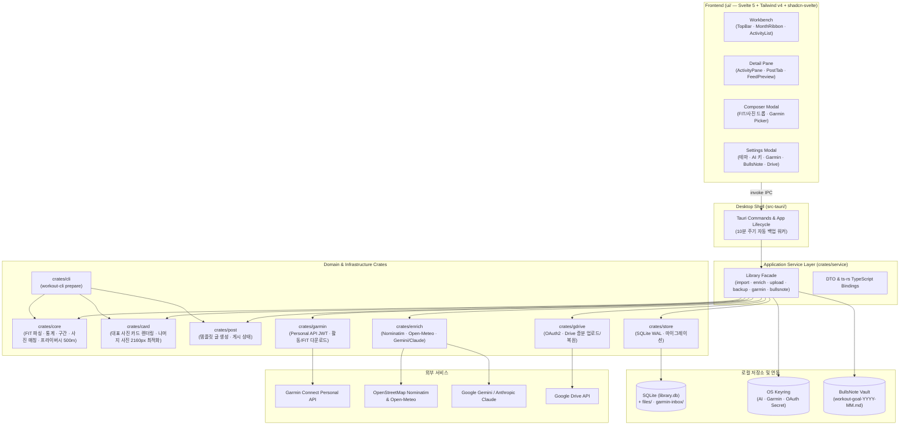
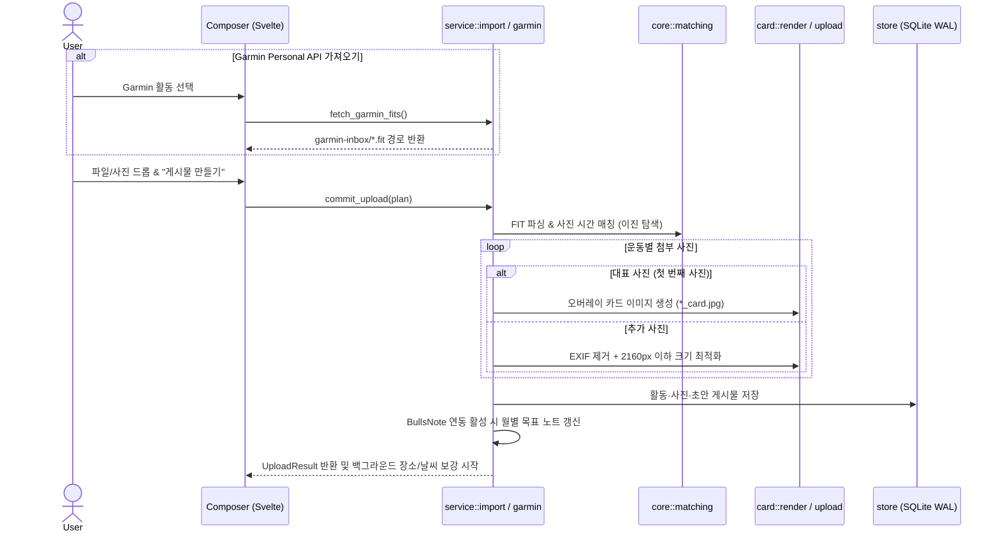

# Workout Threads 아키텍처 구성도

이 문서는 `workout-app`의 현재 구현을 기준으로 전체 시스템 계층, Rust 워크스페이스 크레이트 간 의존 관계, 그리고 주요 데이터 흐름을 정리합니다.

## 1. 전체 시스템 구성도

## 2. 크레이트별 책임

| 크레이트 | 주요 역할 |
|---|---|
| `crates/core` | Garmin `.fit` 파일 디코딩, 거리/고도/심박/페이스 통계, km 스플릿, EXIF 시각 기반 사진-운동 이진 탐색(`binary_search_by_key`) 매칭, 출발·도착 500m 프라이버시 마스킹 |
| `crates/card` | 대표 사진 1장에 운동 요약·경로선 카드 오버레이 렌더링(`Pretendard` 내장), 나머지 첨부 사진 EXIF 제거 및 최대 변 2160px 이하 리사이즈 최적화 |
| `crates/post` | 활동/날씨/장소 컨텍스트 기반 스레드 본문·해시태그 템플릿 렌더링 및 게시 상태 관리 |
| `crates/enrich` | Nominatim 역지오코딩(프라이버시 반경 밖 좌표), Open-Meteo 기상 조회, Gemini/Claude 글 다듬기(선택 시 위치 제거된 저해상도 사진 첨부) |
| `crates/garmin` | Garmin Personal API 키 → JWT Bearer 토큰 교환(24시간 캐시), 활동 목록 조회, `.fit` ZIP 다운로드 및 압축 해제 |
| `crates/gdrive` | Google Desktop OAuth 및 `WorkoutApp` 폴더 증분 백업/복원 |
| `crates/store` | SQLite(`journal_mode = WAL`, `synchronous = NORMAL`) 기반 활동·사진·게시물·월간 목표 영속화 |
| `crates/service` | 위 크레이트를 조합하는 애플리케이션 서비스 파사드, `ts-rs` DTO 바인딩 생성, `bullsnote.rs`를 통한 월별 목표 노트 원자적 갱신 |
| `crates/cli` | 데스크톱 UI 없이 단일 날짜 폴더를 처리하는 CLI (`workout-cli prepare`) |

## 3. 핵심 데이터 흐름

### 3-1. 게시물 작성 및 사진 처리 파이프라인

